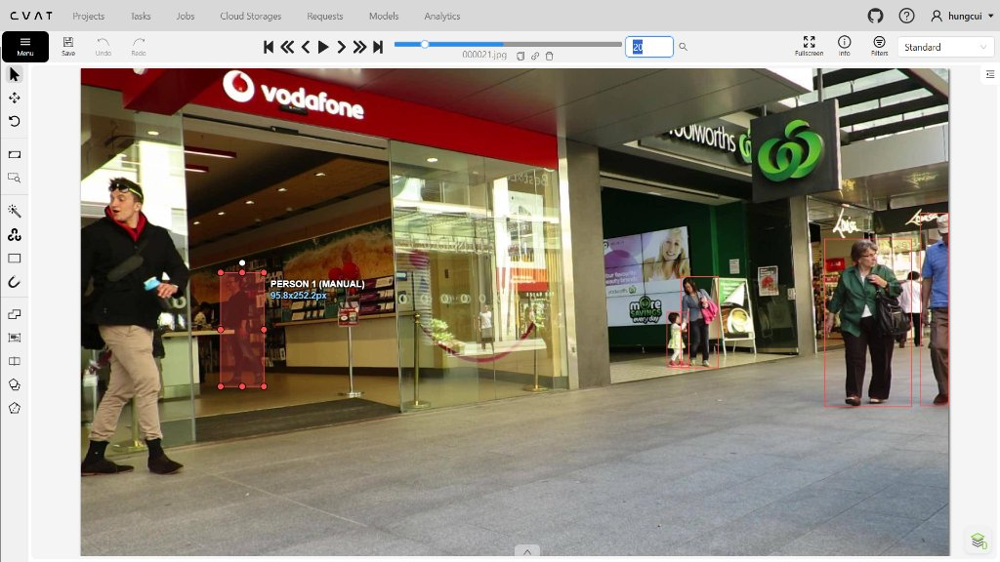
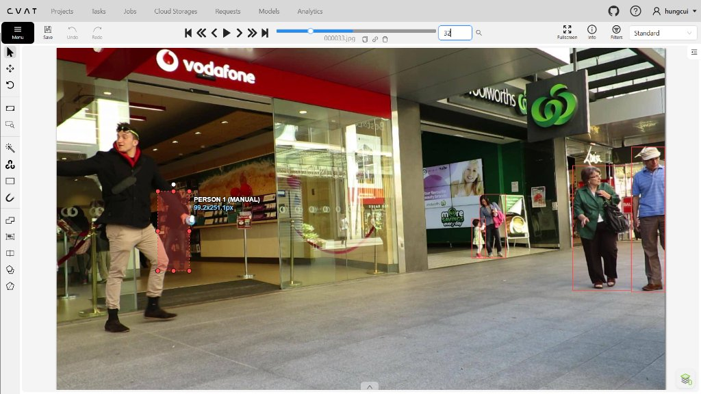
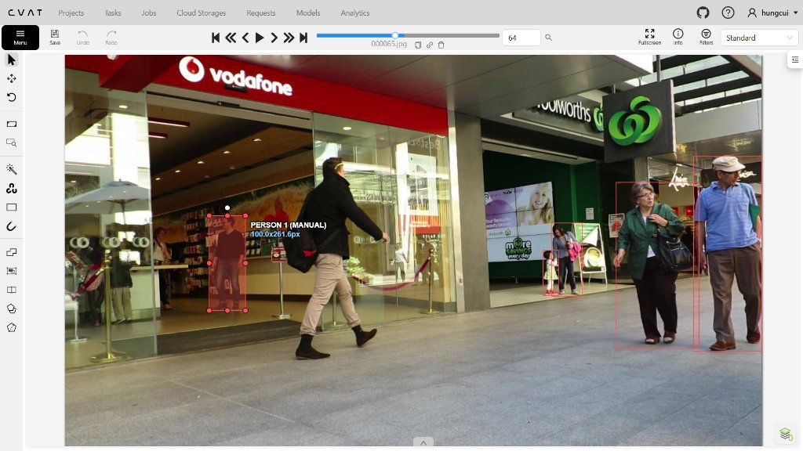

# Báo cáo cá nhân — 202604038_NguyenQuocHung

Đoạn video: MOT17-09, 150 frame (frame 1–150), nguồn MOTChallenge, giấy phép CC BY-NC-SA 3.0.

## 0. Thông tin học viên

- Họ tên: Nguyễn Quốc Hưng
- MSSV: 202604038
- Mã đề: B
- Email: hungcui710@gmail.com
- Link repository: https://github.com/VinUni-AI20k/K5-L2B-DAY05-NguyenQuocHung-04038-MOTTracking
- Giờ bắt đầu: 17:00
- Giờ kết thúc: 19:25

## 1. Xem trước đoạn video (CP0)

Ghi **trước khi vẽ**, mỗi người một dòng.

| Mã | Frame xuất hiện | Frame cuối thấy được | Rẽ / dừng / đổi tốc độ ở frame | Bị che ở frame | Ghi chú |
|---|---|---|---|---|---|
| P1 | 0 | 149 | 20, 60, 110 | 26–51 | Áo len đen trong shop Vodafone, đối tượng test CP2 |
| P2 | 0 | 149 | 80, 112, 125 | Không | Đi thẳng đều phía lề đường bên phải |
| P3 | 0 | 149 | 44, 68, 116 | Không | Đi hướng về camera, kích thước box tăng dần |
| P4 | 0 | 149 | 40, 60 | 106–149 | Bị vật cản/biển hiệu che nửa thân dưới từ frame 106 |
| P5 | 0 | 149 | 30, 50, 100 | 103–149 | Bị người/vật cản che một phần từ frame 103 |

## 2. Keyframe và thời gian (CP1, CP4)

Số keyframe lấy từ kết quả `src/check_submission.py`.

| Mã | Số keyframe | Keyframe ở frame | Số frame có mặt | Keyframe / 100 frame | Thời gian (phút) | Chỗ khó |
|---|---|---|---|---|---|---|
| P1 | 44 | 0, 10, 17, 20, 26, 27, 28, 29, 30, 31, 32, 33, 34, 35, 36, 37, 38, 40, 48, 49, 50, 51, 52, 53, 60, 62, 63, 64, 65, 66, 67, 69, 70, 71, 72, 80, 90, 100, 110, 120, 122, 130, 140, 149 | 150 | 29.3 | 25 | Đoạn che khuất frame 26–51, phải căn amodal box và chỉnh keyframe liên tục |
| P2 | 33 | 0, 10, 20, 30, 40, 50, 60, 70, 80, 82, 90, 93, 100, 110, 112, 113, 114, 115, 116, 117, 118, 119, 120, 122, 124, 125, 126, 129, 130, 133, 140, 144, 149 | 150 | 22.0 | 20 | Frame 112–130 đối tượng đổi bước chân và thay đổi góc nhìn |
| P3 | 25 | 0, 10, 20, 22, 30, 36, 40, 44, 50, 60, 65, 68, 70, 80, 85, 90, 100, 110, 113, 116, 120, 126, 130, 140, 149 | 150 | 16.7 | 15 | Người đi lại gần camera, kích thước box tăng dần cần cập nhật kích thước |
| P4 | 11 | 0, 10, 20, 30, 40, 50, 60, 106, 138, 140, 143 | 150 | 7.3 | 12 | Frame 106 bị che khuất thân dưới, cần bật occluded và kéo box chạm đất |
| P5 | 9 | 0, 10, 20, 30, 40, 50, 90, 100, 103 | 150 | 6.0 | 10 | Bị che một phần từ frame 103, cần giữ amodal box |
| **Tổng** | 122 | | 750 | 16.3 | 82 | |

Keyframe / 100 frame của cả bài = tổng keyframe ÷ tổng số frame có mặt × 100 = 122 ÷ 750 × 100 = 16.3

Bạn đặt keyframe nhiều nhất ở người nào? Vì sao (người đó rẽ, dừng, lại gần camera hay bị che)?

Đặt keyframe nhiều nhất ở đối tượng **P1** (44 keyframe). Lý do là P1 di chuyển bên trong shop Vodafone qua lớp cửa kính và bị người đi ngang qua che khuất liên tục trong đoạn frame 26 đến 51. Trong suốt giai đoạn bị che này, góc nhìn và hình thể bị che khuất một phần khiến nội suy tuyến tính không còn chính xác, do đó cần cắm keyframe dày hơn để căn chỉnh hộp bao amodal bọc sát người và quản lý cờ `occluded`.

## 3. Đoạn bị che (CP2)

Người bị che: `P1`

| Mốc | Frame |
|---|---:|
| Bắt đầu bị che một phần (bật `occluded`) | 26 |
| Mất hẳn (bật `outside`) | 39 |
| Hiện lại (tắt `outside`) | 46 |
| Thấy rõ trở lại (tắt `occluded`) | 52 |

- Thời gian khuất hẳn: 7 frame = 0.23 giây (tại 30 fps).
- Quyết định: giữ cùng ID (Track ID 1).
- Lý do (trả lời 3 câu: khuất bao lâu so với 60 frame, ngoại hình có khớp, chỗ hiện lại có đúng hướng và tốc độ):
  1. **Thời gian khuất:** Khoảng thời gian bị che khuất hoàn toàn chỉ kéo dài 7 frame (~0.23 giây), nhỏ hơn rất nhiều so với ngưỡng quy ước 60 frame (2 giây) của lớp.
  2. **Ngoại hình:** Đối tượng tái xuất hiện hoàn toàn khớp về trang phục (áo len đen), phom người và chiều cao.
  3. **Hướng và vận tốc:** Vị trí xuất hiện ở frame 46 nằm hoàn toàn chuẩn xác trên vector chuyển động tiếp diễn của hướng đi và tốc độ trước khi bị che.

Ảnh chụp màn hình:





## 4. Tự review ID (CP3)

Lượt 1 theo người (đi ngược từ frame 149 về 0 trên CVAT), lượt 2 theo cảnh (nhảy 10 frame). Ít nhất 3 dòng; không có lỗi thì ghi một dòng "đã kiểm hai lượt, không lỗi".

Loại lỗi dùng đúng một trong 7 mã: `id_switch`, `fragmentation`, `lost`, `merge`, `false_track`, `drift`, `flag`.

| Frame | Mã người | Loại lỗi | Mô tả một câu | Phát hiện ở lượt | Đã sửa? |
|---:|---|---|---|---|---|
| 32 | P1 | `drift` | Box bị trôi nhẹ khi người đi ngang qua che khuất một phần thân | Lượt 1 | Có, đã thêm keyframe nắn lại box |
| 115 | P2 | `drift` | Đáy box bị lệch gót chân khi đối tượng sải bước dài | Lượt 1 | Có, đã căn lại đáy box chạm đất |
| 106 | P4 | `flag` | Chưa bật cờ occluded khi bắt đầu bị che nửa thân dưới | Lượt 2 | Có, đã bật occluded từ frame 106 |
| 103 | P5 | `flag` | Bị che một phần thân dưới nhưng sót cờ occluded | Lượt 2 | Có, đã bật occluded từ frame 103 |

Tổng hợp số lỗi theo loại:

| `id_switch` | `fragmentation` | `lost` | `merge` | `false_track` | `drift` | `flag` |
|---:|---:|---:|---:|---:|---:|---:|
| 0 | 0 | 0 | 0 | 0 | 2 | 2 |

Lỗi nào chỉ lượt 2 (theo cảnh) mới thấy, lượt 1 (theo người) không thấy? Vì sao?

Lỗi thiếu cờ `flag` (`occluded`) ở P4 và P5 khi bị vật cản trong khung cảnh che khuất thân dưới: Ở Lượt 1 khi tua ngược và chỉ tập trung vào một đối tượng, người gán nhãn rất dễ chỉ chú ý vào biên của người đó mà bỏ qua các vật thể xung quanh. Sang Lượt 2 xem tổng thể bối cảnh xuôi theo thời gian, mối quan hệ giữa người đi bộ và các chướng ngại vật tĩnh (biển hiệu, bàn ghế) hiển hiện rõ ràng hơn, giúp lập tức nhận diện được thời điểm đối tượng bắt đầu bị che khuất.

## 5. File xuất và kết quả tự kiểm (CP4)

| Kiểm tra | Kết quả |
|---|---|
| Tên file MOT 1.1 | NguyenQuocHung_mot.zip |
| Tên file CVAT for video 1.1 | NguyenQuocHung_cvat_video.zip |
| Số track ID khác nhau trong `gt/gt.txt` (phải là 5) | 5 |
| Frame `outside` không có dòng trong `gt.txt` (đúng / sai) | Đúng |
| Job đã completed trên CVAT máy cá nhân | Có (Completed) |

Dán phần tóm tắt in ra từ `src/check_submission.py`:

```text
Số frame in theo CVAT (bắt đầu từ 0). Trong gt.txt, frame_id = frame CVAT + 1.

=== File MOT 1.1: NguyenQuocHung_mot.zip ===
  Số track ID: 5   |   Tổng số box: 750
  [OK]        Đúng 5 track ID.

  Track | Frame có mặt | Số frame | Đoạn vắng (outside)
      1 |   0–149      |      150 | -
      2 |   0–149      |      150 | -
      3 |   0–149      |      150 | -
      4 |   0–149      |      150 | -
      5 |   0–149      |      150 | -


=== File CVAT for video 1.1: NguyenQuocHung_cvat_video.zip ===

  Track | Nhãn   | Frame thấy | Keyframe | KF/100 frame | Frame occluded | Lần bật outside
      0 | person |        150 |       44 |         29.3 |             24 |               0
      1 | person |        150 |       33 |         22.0 |              0 |               0
      2 | person |        150 |       25 |         16.7 |              0 |               0
      3 | person |        150 |       11 |          7.3 |             39 |               0
      4 | person |        150 |        9 |          6.0 |             47 |               0

  Tổng: 122 keyframe / 750 frame có mặt = 16.3 keyframe / 100 frame
  [OK]        Đọc được 5 track từ annotations.xml.

=== Tóm tắt ===
  Lỗi: 0   |   Cảnh báo: 0
  Đạt. 
```

## 6. Ba câu kết

1. Nếu được gán lại, bạn sẽ đặt keyframe khác ở đâu? Vì sao?

   Tôi sẽ tối ưu lại việc cắm keyframe cho đối tượng P1 ở giai đoạn frame 26–38 (thay vì cắm liên tiếp từng frame, tôi có thể dãn ra 2–3 frame một keyframe kết hợp căn chỉnh tỉ mỉ). Việc phân bố đều và hợp lý hơn sẽ giúp đường nội suy mượt mà, tránh tình trạng giật box và giảm bớt thời gian thao tác dư thừa.

2. Có chỗ nào bạn không chắc "cùng ID hay ID mới"? Bạn đã quyết định và ghi chú thế nào?

   Đoạn P1 bị che khuất hoàn toàn khi có người đi ngang qua cửa hàng Vodafone ở frame 39–45. Vì đối tượng ở xa và bị che lấp trong một khoảng ngắn, có rủi ro nhầm lẫn với người khác. Tôi đã áp dụng bộ tiêu chí 3 bước (thời gian khuất < 2 giây, trang phục áo len đen không đổi, vị trí xuất hiện trùng khớp hoàn hảo với quỹ đạo di chuyển) để quyết định giữ nguyên cùng Track ID 1.

3. Một lỗi ID trong job của bạn (nếu không còn sót, chọn lỗi đã sửa) có thể làm xe tự lái dự đoán sai chuyển động của người đó như thế nào? Lỗi đó ảnh hưởng MOTA hay IDF1 nhiều hơn?

   Nếu xảy ra lỗi `id_switch` (ví dụ gán nhầm ID của P1 sang người đi ngang qua), bộ lọc Kalman và mô đun dự báo quỹ đạo của xe tự lái sẽ tính toán một bước nhảy vị trí tức thời trong khoảng thời gian 1/30 giây (tương đương vận tốc nhảy vọt hàng trăm km/h). Điều này khiến hệ thống dự đoán sai hướng di chuyển, có thể dẫn đến phản ứng phanh gấp nguy hiểm hoặc đánh lái khẩn cấp sai lệch. Lỗi này ảnh hưởng đến **IDF1** nặng hơn rất nhiều so với MOTA, bởi vì IDF1 đo lường khả năng duy trì định danh xuyên suốt toàn bộ hành trình của đối tượng (mỗi người thật chỉ khớp với một ID duy nhất), trong khi MOTA chủ yếu phản ánh độ chính xác phát hiện (detection) của từng frame độc lập.

## 7. Tài liệu tham khảo và công cụ AI đã dùng

- MOTChallenge MOT17 Benchmark (Milan et al., 2016).
- Tài liệu hướng dẫn sử dụng công cụ CVAT (CVAT.ai Documentation).
- Bộ hướng dẫn thực hành Lab Day 05: Multi-Object Tracking (Level 2 Computer Vision).

